# Dossier d’architecture technique — Euphrosyne

**Projet :** Euphrosyne — C2RMF / New AGLAE.

**Dépôts :** [Plateforme Euphrosyne](https://github.com/betagouv/euphrosyne),
[Catalogue de données](https://github.com/betagouv/euphrosyne-digilab),
[Tools API](https://github.com/betagouv/euphrosyne-tools-api),
[infrastructure](https://github.com/betagouv/euphrosyne-tools-infra),
[Herma](https://github.com/betagouv/euphrosyne-herma).

**Hébergement :**

Scalingo héberge les trois applications web : Plateforme Euphrosyne, Catalogue
de données et Tools API. Microsoft Azure héberge les fichiers scientifiques et
les services de bureau distant.

- **Production**, utilisée par les équipes : Scalingo `osc-secnum-fr1` (Paris) ; Azure en `westeurope`, avec des ressources supplémentaires en `polandcentral`.
- **Staging**, utilisé pour tester les évolutions : Scalingo `osc-fr1` (Paris) ; Azure en `westeurope`, avec des ressources supplémentaires en `polandcentral`.

**Homologation :** en préparation ; commission prévue en décembre 2026.

## Suivi

Le suivi de ce document est fait via le versionnage Git.

## Contributeurs

| Organisation | Contributeur      | Rôle                | État        |
| ------------ | ----------------- | ------------------- | ----------- |
| Euphrosyne   | Witold Wroblewski | Expertise technique | En écriture |

## Description du projet

Euphrosyne est un ensemble de services numériques destiné aux chercheurs et aux
équipes du laboratoire qui étudient les matériaux du patrimoine. Il accompagne
les analyses réalisées avec New AGLAE, l’accélérateur de particules du Centre de
recherche et de restauration des musées de France (C2RMF), utilisé pour étudier
la composition des matériaux.

La **Plateforme Euphrosyne** rassemble les informations sur les projets de
recherche, les objets étudiés et les expériences. Les équipes y documentent leurs
travaux dans un cahier de laboratoire, consultent les fichiers scientifiques et
accèdent à des outils de traitement à distance.

Le **Catalogue de données** permet de retrouver les projets et les objets,
de consulter leur description et de demander l’accès aux données produites.
Leur diffusion dépend des droits et des conditions d’accès associés aux projets.

**Herma** est l’outil utilisé par les administrateurs du laboratoire pour déposer
les fichiers issus des analyses dans le stockage scientifique d’Euphrosyne.

## Architecture

Le périmètre couvre les services en production et en staging, les machines
virtuelles de traitement et Herma sur les postes du laboratoire.

### Socle technique

Les composants ont des responsabilités distinctes. La plateforme porte les
règles métier ; le catalogue présente les données ; Tools API organise l’accès
aux fichiers et aux moyens de traitement.

| Composant                | Rôle                                                                                             | Technologies principales                                                               |
| ------------------------ | ------------------------------------------------------------------------------------------------ | -------------------------------------------------------------------------------------- |
| Plateforme Euphrosyne    | Gérer les comptes, projets, objets, expériences et demandes de données                           | Django/DRF ; React/DSFR pour l’interface                                               |
| Catalogue de données     | Présenter les projets et objets et envoyer les recherches/demandes à la plateforme               | Next.js, React, TypeScript                                                             |
| Tools API                | Accéder aux fichiers, organiser les transferts et l’archivage, créer les machines de traitement  | FastAPI ; Python Azure SDK                                                             |
| Herma                    | Déposer les fichiers depuis les postes des administrateurs du laboratoire                        | Python/PySide6 ; AzCopy pour le transfert                                              |
| Stockage et recherche    | Conserver les métadonnées, retrouver les projets et stocker les fichiers scientifiques et images | PostgreSQL, Elasticsearch, Azure Files et Blob                                         |
| Bureau distant           | Utiliser une machine de traitement depuis le navigateur                                          | VM Windows Azure, Guacamole/guacd ; MySQL pour les connexions et permissions Guacamole |
| Livraison et observation | Tester et déployer les applications, suivre les erreurs et l’audience                            | GitHub Actions, buildpacks Scalingo, Sentry, Matomo                                    |
| Infrastructure           | Gestion de l’infrastructure                                                                      | Terraform, Bicep                                                                       |

Azure Files conserve les fichiers de travail, dits **HOT**. Azure Blob conserve
les fichiers archivés, dits **COOL**, ainsi que les images dans un espace distinct.
Les fichiers persistent après la suppression d’une machine de traitement.

En production, Scalingo exécute un conteneur web pour la plateforme, quatre pour
Tools API et un pour le catalogue. Ils utilisent la classe M, limitée nominalement
à 512 Mo de mémoire par conteneur. Les volumes, la charge et les quotas de calcul
restent à préciser pour valider le dimensionnement.

### Matrice des communications

Cette matrice présente les principaux échanges entre services. « Interne »
désigne un composant du système Euphrosyne ; cela ne garantit ni un réseau privé
ni un transport chiffré.

| Source                                         | Destination                                              | Protocole                 | Port                      | Localisation de destination | Type                     |
| ---------------------------------------------- | -------------------------------------------------------- | ------------------------- | ------------------------- | --------------------------- | ------------------------ |
| Navigateur                                     | Plateforme Euphrosyne, Catalogue de données, Tools API   | HTTPS                     | 443                       | Paris                       | Interne                  |
| Catalogue de données                           | API de la Plateforme Euphrosyne                          | HTTPS                     | 443                       | Paris                       | Interne                  |
| Plateforme Euphrosyne                          | Tools API — opérations sur les fichiers et machines      | HTTPS / JWT               | 443                       | Paris                       | Interne                  |
| Tools API                                      | Plateforme Euphrosyne — notifications de fin d’opération | HTTPS / JWT               | 443                       | Paris                       | Interne                  |
| Plateforme Euphrosyne                          | PostgreSQL                                               | TCP ; TLS à vérifier      | Configuré ; 5432 standard | Paris                       | Interne                  |
| Plateforme Euphrosyne                          | Elasticsearch                                            | HTTP                      | 30526 configuré           | Paris                       | Interne                  |
| Herma                                          | Plateforme Euphrosyne / Tools API                        | HTTPS attendu / JWT       | 443                       | Paris                       | Interne                  |
| Applications / Herma / navigateur              | Azure Files / Blob                                       | HTTPS / SAS               | 443                       | `westeurope`                | Interne                  |
| Tools API                                      | API Azure / Entra / Key Vault                            | HTTPS                     | 443                       | Selon service               | Externe — contrôle cloud |
| Navigateur / Tools API                         | Guacamole                                                | HTTPS                     | 443                       | `westeurope`                | Interne                  |
| Guacamole                                      | guacd / MySQL                                            | TCP ; TLS à vérifier      | 4822 / 3306               | `westeurope`                | Interne                  |
| guacd                                          | VM Windows                                               | RDP                       | 3389 standard             | Europe                      | Interne                  |
| VM / guacd                                     | Azure Files                                              | SMB                       | 445 standard              | `westeurope`                | Interne                  |
| Navigateur / Plateforme Euphrosyne             | ORCID                                                    | OAuth2 / HTTPS            | 443                       | États-Unis                  | Externe                  |
| Tally                                          | Webhook de la Plateforme Euphrosyne                      | HTTPS / HMAC-SHA256       | 443                       | Paris                       | Externe — quiz           |
| Plateforme Euphrosyne                          | Goodflag du ministère                                    | HTTPS                     | 443                       | France                      | Externe — signature      |
| Plateforme Euphrosyne                          | Mailjet                                                  | SMTP / STARTTLS configuré | 587                       | Europe                      | Externe                  |
| Applications / Herma                           | Sentry                                                   | HTTPS                     | 443                       | France                      | Externe                  |
| Navigateur de la Plateforme Euphrosyne         | Matomo                                                   | HTTPS                     | 443                       | France                      | Externe — audience       |
| Plateforme Euphrosyne / navigateur / Tools API | EROS, POP/IIIF, OpenTheso, GeoNames, ROR                 | HTTP(S)                   | 80 / 443                  | -                           | Externe                  |

JWT et SAS décrivent l’autorisation, en complément du protocole de transport.
Un **JWT** est un jeton signé utilisé pour identifier un utilisateur ou un service.
Un **SAS** donne un accès limité dans le temps à des fichiers ou à un espace de
stockage Azure. Les ports indiqués comme « standard » restent à confirmer dans
la configuration effective.

### Dépendances

Le tableau regroupe les principales briques logicielles. Les versions des
bibliothèques proviennent des fichiers de dépendances associés aux révisions
déployées ; celles des bases ont été relevées chez les hébergeurs. Une version
« déclarée » ou « verrouillée » ne prouve pas à elle seule la version installée.

| Composant                                 | Dépendances principales              | Version / référence                                                      |
| ----------------------------------------- | ------------------------------------ | ------------------------------------------------------------------------ |
| Plateforme Euphrosyne                     | Python ; Django ; DRF ; SimpleJWT    | 3.12 déclaré ; 6.0.7 ; 3.18.0 ; 5.5.1                                    |
| Interface web de la Plateforme Euphrosyne | React ; DSFR ; Webpack               | 19.2.6 ; 1.14.4 ; 5.109.2 verrouillés                                    |
| Catalogue de données                      | Next.js ; React ; react-dsfr         | 16.3.8 ; 19.3.0 ; 1.35.0 verrouillés                                     |
| Tools API                                 | Python ; FastAPI ; Uvicorn ; h5grove | 3.14 déclaré ; 0.141.1 ; 0.53.0 ; branche Git, commit résolu à confirmer |
| Bases                                     | PostgreSQL ; Elasticsearch ; MySQL   | 15.12.0-2 ; 7.10.2-2 ; 8.0.21 relevés                                    |
| Bureau distant                            | Guacamole / guacd                    | Images configurées 1.6.0 ; digests à relever                             |
| Herma                                     | Python ; PySide6 ; AzCopy            | Build Python 3.11 ; 6.9.1 déclaré ; version AzCopy installée à confirmer |
| Infrastructure                            | Terraform ; fournisseur azurerm      | ≥ 1.1.0 déclaré ; 3.44.1 verrouillé                                      |

### Diagramme des services

Les six vues suivent les principaux usages : travailler sur un projet, consulter
le catalogue, déposer des fichiers avec Herma, utiliser un bureau distant,
suivre la radioprotection et exploiter le service. Un composant repris dans
plusieurs vues désigne le même service. Le catalogue et la radioprotection
s’appuient sur le serveur Django de la Plateforme Euphrosyne.

#### 1a. Plateforme Euphrosyne — applications et données


#### 1b. Catalogue de données — consultation et recherche


À la construction des pages, le Catalogue de données demande la liste des
projets à l’API de la Plateforme Euphrosyne. Lors de la consultation, les
requêtes de recherche passent aussi par cette API. Dans les deux cas, l’API
interroge Elasticsearch en HTTP, puis renvoie les données au Catalogue de données.

#### 2a. Upload laboratoire — Herma / AzCopy


#### 2b. Bureau distant — environnement réseau privé Azure


#### 3a. Service radioprotection — quiz et signatures


#### 4. Livraison, observation et protection des données


### Diagramme de structure des bases de données

La base métier **PostgreSQL** rassemble les comptes, projets, expériences,
objets, résultats de formation, demandes d’accès et états du stockage. Son
schéma a été reconstruit le **8 octobre 2026** sur une base locale isolée en
appliquant **131 migrations**, à partir de la révision `e953c584`.

#### Projets, utilisateurs et participations


#### Expériences, objets et mesures


#### Formation, prévention et signature


#### Demandes de données et cycle de stockage


#### Authentification et tables techniques


## Exigences

Cette section explique comment sont protégés les accès, les données et
l’exploitation du service. Elle présente les mesures identifiées en production.

### Accès aux serveurs et sécurité des communications

L’administration passe par Scalingo, Azure et GitHub. Ces
comptes utilisent une authentification à plusieurs facteurs (MFA).
Les secrets
techniques sont fournis par la configuration des applications et, selon le
service, par Azure Key Vault.
Les secrets liés à Azure ont une durée de vie de
six mois et sont renouvelés régulièrement.

Les accès web utilisent HTTPS. Azure Storage et Guacamole exigent au minimum
TLS 1.2 pour chiffrer les échanges.

### Authentification applicative et contrôle d’accès

Un utilisateur se connecte à la Plateforme Euphrosyne avec son compte ou via
ORCID, un service d’identification des chercheurs. Les droits dépendent de son
appartenance aux projets et de son rôle : membre, responsable de projet,
administrateur du laboratoire ou superutilisateur. Tools API vérifie les jetons
et les droits projet ; les SAS autorisent certains accès temporaires au stockage.
Les pages du Catalogue de données sont actuellement protégées par un identifiant
et un mot de passe distincts, au moyen de l’authentification HTTP Basic.

Les sessions web de la Plateforme Euphrosyne expirent après 15 minutes
d’inactivité pour les administrateurs du laboratoire et les superutilisateurs,
et après 60 minutes pour les autres utilisateurs. Chaque requête authentifiée
par le cookie de session, y compris un appel automatique en arrière-plan,
renouvelle ce délai. Une session expirée impose une reconnexion lors du prochain
accès protégé ; une page déjà ouverte reste affichée jusqu’à la requête suivante.
Les sessions existantes adoptent cette politique à leur prochaine requête
authentifiée. Les paramètres Django `SESSION_IDLE_TIMEOUT_ADMIN` et
`SESSION_IDLE_TIMEOUT_USER` définissent ces durées en secondes. Cette expiration
ne modifie pas la durée de validité des JWT ni les règles des bureaux distants.

Pour les bureaux distants, les JWT d’accès expirent
après cinq minutes par défaut au code, le jeton
Guacamole au bout de 60 minutes après inactivité.

### Suivi de l’activité

Sentry signale les erreurs et fournit leur contexte pour aider au diagnostic.
Matomo mesure l’audience et les interactions de la Plateforme Euphrosyne.
Les journaux Scalingo et Azure complètent l’observation technique, selon leur
configuration.

### Politique de mise à jour de l’application

Dependabot propose chaque semaine des mises à jour des dépendances Python et
npm de la plateforme. GitHub Actions exécute les tests et contrôles lors des
évolutions du code.

### Intégrité

Les sauvegardes et mécanismes de récupération servent à retrouver les données
après une erreur ou une perte. Leur couverture dépend du stockage.

| Données                          | Protection documentée                                                                      | Conservation / limite                         |
| -------------------------------- | ------------------------------------------------------------------------------------------ | --------------------------------------------- |
| Métadonnées PostgreSQL           | Sauvegarde quotidienne                                                                     | 7 jours et 4 semaines selon l’équipe          |
| Fichiers scientifiques HOT       | Sauvegarde Azure Files                                                                     | 20 jours et 6 semaines observés en production |
| Fichiers archivés COOL           | Historique des versions, récupération après suppression et restauration temporelle de Blob | Protections natives                           |
| Comptes et connexions Guacamole  | Sauvegarde quotidienne de MySQL                                                            | 7 jours                                       |
| Index de recherche Elasticsearch | Reconstruction depuis les données PostgreSQL                                               | Possibilité déclarée ; procédure à tester     |

Aucun test de restauration n’a encore été réalisé selon les informations fournies.
Il faut vérifier la reprise du service et l’existence de copies indépendantes,
puis définir avec Claire le délai de rétablissement acceptable (RTO) et la perte
de données maximale acceptable, exprimée en durée (RPO).

### Vie privée

Se référer à la poitique de confidentialité [lien à venir].
