# Dossier d’architecture technique — Euphrosyne

**Projet :** Euphrosyne — C2RMF / New AGLAE.

**Dépôts :** [Plateforme Euphrosyne](https://github.com/betagouv/euphrosyne),
[Catalogue de données](https://github.com/betagouv/euphrosyne-digilab),
[Tools API](https://github.com/betagouv/euphrosyne-tools-api),
[infrastructure](https://github.com/betagouv/euphrosyne-tools-infra),
[Herma](https://github.com/betagouv/euphrosyne-herma).

**Hébergement :**

Scalingo héberge les applications web : Plateforme Euphrosyne, Tools API et
Catalogue de données. Microsoft Azure héberge les fichiers scientifiques et
les services de bureau distant.

- **Production**, utilisée par les équipes : Scalingo à Paris, sur une région
  qualifiée SecNumCloud ; Azure en `westeurope` et `polandcentral`.
- **Staging**, utilisé pour tester les évolutions : Scalingo à Paris, hors
  SecNumCloud ; Azure en `westeurope` et `polandcentral`.

**Homologation :** en préparation ; commission prévue en décembre 2026.

## Suivi

Le suivi de ce document est fait via le versionnage Git.

## Contributeurs

| Organisation | Contributeur      | Rôle                |
| ------------ | ----------------- | ------------------- |
| Euphrosyne   | Witold Wroblewski | Expertise technique |

## Description du projet

Euphrosyne est un ensemble de services numériques destiné aux chercheurs et aux
équipes du laboratoire qui étudient les matériaux du patrimoine. Il accompagne
les analyses réalisées avec New AGLAE, l’accélérateur de particules du Centre de
recherche et de restauration des musées de France (C2RMF), utilisé pour étudier
la composition des matériaux.

La **Plateforme Euphrosyne** rassemble les informations sur les projets de
recherche, les objets étudiés et les expériences. Les équipes y documentent leurs
travaux dans un cahier de laboratoire, consultent les fichiers scientifiques et
accèdent à des outils de traitement à distance.

Le **Catalogue de données** permet de retrouver les projets et les objets,
de consulter leur description et de demander l’accès aux données produites.
Les projets confidentiels, ou dont le responsable n’a pas accepté les conditions
d’utilisation, n’y apparaissent pas.

**Herma** est l’outil utilisé par les administrateurs du laboratoire pour déposer
les fichiers issus des analyses dans le stockage scientifique d’Euphrosyne.

## Architecture

Le périmètre couvre les services en production et en staging, les machines
virtuelles de traitement et Herma sur les postes du laboratoire.

### Socle technique

Les composants ont des responsabilités distinctes. La plateforme porte les
règles métier ; le catalogue présente les données ; Tools API organise l’accès
aux fichiers et aux moyens de traitement.

| Composant              | Rôle                                                                                                | Technologies principales                           |
| ---------------------- | --------------------------------------------------------------------------------------------------- | -------------------------------------------------- |
| Plateforme Euphrosyne  | Gérer les comptes, projets, objets, expériences et demandes de données ; émettre les jetons d’accès | Django ; React                                     |
| Catalogue de données   | Présenter les projets et objets et envoyer les recherches et demandes à la plateforme               | Next.js, React, TypeScript                         |
| Tools API              | Accéder aux fichiers, organiser les transferts et l’archivage, créer les machines de traitement     | FastAPI                                            |
| Herma                  | Déposer les fichiers depuis les postes des administrateurs du laboratoire                           | Python, PySide6 ; AzCopy pour le transfert         |
| Stockage et recherche  | Conserver les métadonnées, retrouver les projets et stocker les fichiers scientifiques et images    | PostgreSQL, Elasticsearch, Azure Files et Blob     |
| Bureau distant         | Utiliser une machine de traitement depuis le navigateur                                             | Machine virtuelle Windows Azure, Guacamole (passerelle de bureau distant) ; MySQL |
| Livraison et suivi     | Tester et déployer les applications, suivre les erreurs, mesurer l’audience                          | GitHub Actions, buildpacks Scalingo, Sentry, Matomo |
| Infrastructure         | Gestion de l’infrastructure                                                                         | Terraform, Bicep                                   |

Azure Files conserve les fichiers de travail, dits **HOT**. Azure Blob conserve
les fichiers archivés, dits **COOL**, ainsi que les images dans un espace distinct.

### Matrice des communications

Cette matrice présente les principaux échanges entre services, regroupés par
source. « Interne »
désigne un composant du système Euphrosyne. Un **JWT** est un jeton signé utilisé
pour identifier un utilisateur ou un service. Un **WAF** est un pare-feu
applicatif web, qui filtre les requêtes. Un **SAS** donne un accès limité
dans le temps à des fichiers ou à un espace de stockage Azure.

#### Navigateur

| Destination                              | Protocole      | Port     | Localisation de destination | Type    | Note                                                                                        |
| ---------------------------------------- | -------------- | -------- | --------------------------- | ------- | ------------------------------------------------------------------------------------------- |
| WAF                                      | HTTPS          | 443      | France                      | Externe | Filtrage des requêtes                                                                       |
| Guacamole                                | HTTPS          | 443      | `westeurope`                | Interne | Bureau distant                                                                              |
| Azure Files / Blob                       | HTTPS / SAS    | 443      | `westeurope`                | Interne | Accès direct aux fichiers                                                                   |
| ORCID                                    | OAuth2 / HTTPS | 443      | États-Unis                  | Externe | Identification des chercheurs                                                               |
| Tally                                    | HTTPS          | 443      | Union européenne            | Externe | Questionnaire de radioprotection, depuis le navigateur du participant                       |
| Matomo                                   | HTTPS          | 443      | France                      | Externe | Mesure d’audience                                                                           |
| EROS, POP/IIIF, OpenTheso, GeoNames, ROR | HTTP(S)        | 80 / 443 | Divers                      | Externe | Référentiels et images externes, aussi appelés par la Plateforme Euphrosyne et la Tools API |

#### Plateforme Euphrosyne

| Destination           | Protocole       | Port | Localisation de destination | Type    | Note                                                                               |
| --------------------- | --------------- | ---- | --------------------------- | ------- | ---------------------------------------------------------------------------------- |
| WAF                   | HTTPS           | 443  | France                      | Externe | Vers la Tools API : opérations sur les fichiers et machines                        |
| PostgreSQL            | TCP             | 5432 | Paris                       | Interne |                                                                                    |
| Elasticsearch         | HTTP            | —    | Paris                       | Interne |                                                                                    |
| Azure Files / Blob    | HTTPS / SAS     | 443  | `westeurope`                | Interne | Images et ressources de la Plateforme                                              |
| ORCID                 | OAuth2 / HTTPS  | 443  | États-Unis                  | Externe | Identification des chercheurs                                                      |
| Goodflag du ministère | HTTPS           | 443  | France                      | Externe | Signature électronique                                                             |
| Mailjet               | SMTP / STARTTLS | 587  | Europe                      | Externe | Envoi d’e-mails                                                                    |
| Sentry                | HTTPS           | 443  | France                      | Externe | Suivi des erreurs, également depuis la Tools API, le Catalogue de données et Herma |

#### Tools API

| Destination        | Protocole   | Port | Localisation de destination | Type    | Note                                                                                       |
| ------------------ | ----------- | ---- | --------------------------- | ------- | ------------------------------------------------------------------------------------------ |
| WAF                | HTTPS       | 443  | France                      | Externe | Vers la Plateforme Euphrosyne : notifications de fin d’opération, jetons et clés publiques |
| Guacamole          | HTTPS       | 443  | `westeurope`                | Interne | Droits d’accès au bureau distant                                                           |
| Azure Files / Blob | HTTPS / SAS | 443  | `westeurope`                | Interne | Fichiers scientifiques et archives                                                         |
| API Azure          | HTTPS       | 443  | `westeurope`                | Externe | Gestion des machines virtuelles et du bureau distant                                       |
| Key Vault          | HTTPS       | 443  | `westeurope`                | Externe | Lecture des secrets                                                                        |
| Entra              | HTTPS       | 443  | `westeurope`                | Externe | Authentification de la Tools API auprès d’Azure                                            |

#### Catalogue de données

| Destination | Protocole | Port | Localisation de destination | Type    | Note                                                                         |
| ----------- | --------- | ---- | --------------------------- | ------- | ---------------------------------------------------------------------------- |
| WAF         | HTTPS     | 443  | France                      | Externe | Vers la Plateforme Euphrosyne : recherches et demandes de données, via l’API |

#### Herma

| Destination        | Protocole                   | Port | Localisation de destination | Type    | Note                                                                     |
| ------------------ | --------------------------- | ---- | --------------------------- | ------- | ------------------------------------------------------------------------ |
| WAF                | HTTPS / OpenID Connect, JWT | 443  | France                      | Externe | Authentification et appels vers la Plateforme Euphrosyne et la Tools API |
| Azure Files / Blob | HTTPS / SAS                 | 443  | `westeurope`                | Interne | Dépôt des fichiers par AzCopy                                            |

#### Machines virtuelles / Guacamole / guacd

| Source                    | Destination               | Protocole | Port | Localisation de destination    | Type    |
| ------------------------- | ------------------------- | --------- | ---- | ------------------------------ | ------- |
| Guacamole                 | guacd                     | TCP       | 4822 | `westeurope`                   | Interne |
| Guacamole                 | MySQL                     | TCP       | 3306 | `westeurope`                   | Interne |
| guacd                     | Machine virtuelle Windows | RDP       | 3389 | `westeurope` / `polandcentral` | Interne |
| guacd                     | Azure Files               | SMB       | 445  | `westeurope`                   | Interne |
| Machine virtuelle Windows | Azure Files               | SMB       | 445  | `westeurope`                   | Interne |

#### Services tiers

| Source    | Destination                                            | Protocole | Port | Localisation de destination | Type    | Note                                                       |
| --------- | ------------------------------------------------------ | --------- | ---- | --------------------------- | ------- | ---------------------------------------------------------- |
| WAF       | Plateforme Euphrosyne, Tools API, Catalogue de données | HTTPS     | 443  | Paris                       | Interne | Après filtrage                                             |
| Tally     | WAF                                                    | HTTPS     | 443  | France                      | Externe | Vers la Plateforme Euphrosyne : résultats du questionnaire |
| API Azure | Tools API                                              | HTTPS     | 443  | Paris                       | Externe | Notifications de changement d’adresse de guacd             |

### Dépendances

Versions principales à la date du document.

| Composant             | Technologies                                 |
| --------------------- | -------------------------------------------- |
| Plateforme Euphrosyne | Python 3.12, Django 6.1                      |
| Catalogue de données  | Next.js 16, React 19                         |
| Tools API             | Python 3.14, FastAPI 0.165                   |
| Herma                 | Python 3.11, PySide6 6.9                     |
| Bases                 | PostgreSQL 15, Elasticsearch 7.10, MySQL 8.0 |
| Bureau distant        | Guacamole 1.6                                |

### Diagramme des services

Les six vues présentent les principaux usages : travailler sur un projet,
consulter le catalogue, déposer des fichiers avec Herma, utiliser un bureau
distant, suivre la radioprotection et exploiter le service. Un composant repris
dans plusieurs vues désigne le même service.

#### 1a. Plateforme Euphrosyne — applications et données

#### 1b. Catalogue de données — consultation et recherche

Le Catalogue de données interroge l’API de la Plateforme Euphrosyne, qui
interroge Elasticsearch.

#### 2a. Dépôt de fichiers — Herma / AzCopy

#### 2b. Bureau distant — réseau privé Azure

#### 3. Service radioprotection — questionnaire et signatures

#### 4. Livraison, observation et protection des données

### Diagramme de structure des bases de données

La base métier **PostgreSQL** rassemble les comptes, projets, expériences,
objets, résultats de formation, demandes d’accès et états du stockage. Les cinq
vues suivantes en présentent les tables et leurs relations principales.

#### Projets, utilisateurs et participations

#### Expériences, objets et mesures

#### Formation, prévention et signature

#### Demandes de données et cycle de stockage

#### Authentification et tables techniques

## Exigences

Cette section explique comment sont protégés les accès, les données et
l’exploitation du service.

### Accès aux serveurs et sécurité des communications

L’administration passe par Scalingo, Azure et GitHub. Ces comptes utilisent une
authentification à plusieurs facteurs (MFA). Les secrets techniques sont fournis
par la configuration des applications et, selon le service, par Azure Key Vault.
Les secrets liés à Azure ont une durée de vie de six mois et sont renouvelés
régulièrement.

Les accès web utilisent HTTPS. Azure Storage et Guacamole exigent au minimum
TLS 1.2. Les cookies de session de la Plateforme Euphrosyne sont marqués
« sécurisés » et ne sont envoyés qu’en HTTPS.

Le WAF filtre les requêtes adressées à la Plateforme Euphrosyne, à la Tools API et
au Catalogue de données.

### Authentification applicative et contrôle d’accès

Un utilisateur se connecte à la Plateforme Euphrosyne avec son compte ou via
ORCID, un service d’identification des chercheurs. Les droits dépendent de son
appartenance aux projets et de son rôle : membre, responsable de projet,
administrateur du laboratoire ou superutilisateur. Les administrateurs du
laboratoire doivent activer une seconde étape de connexion par code temporaire ;
un superutilisateur réinitialise la double authentification d’un compte après
vérification d’identité. Après cinq échecs de connexion par mot de passe en
15 minutes pour une même adresse e-mail, la connexion par mot de passe est
refusée jusqu’à l’expiration de la fenêtre. Une session web expire après
15 minutes d’inactivité pour un administrateur et 60 minutes pour les autres
utilisateurs.

La Plateforme Euphrosyne émet elle-même les jetons d’accès utilisés par les API.
Ce sont des JWT signés, qui expirent après cinq minutes. Les autres services
vérifient la signature des jetons. La Tools API vérifie aussi les droits sur le
projet et obtient ses propres jetons auprès de la Plateforme Euphrosyne par
OpenID Connect. Herma obtient le sien de la même façon : seul un administrateur
du laboratoire peut l’autoriser, et Herma conserve en plus un jeton de
renouvellement, valable 24 heures et renouvelé à chaque usage. Les SAS autorisent
certains accès temporaires au stockage.

Le Catalogue de données est protégé par un identifiant et un mot de passe
partagés (authentification HTTP), distincts des comptes de la Plateforme
Euphrosyne.

Pour les bureaux distants, une machine virtuelle est créée par projet et seuls
les membres du projet y accèdent. Le jeton Guacamole expire au bout de
60 minutes après inactivité.

### Suivi de l’activité

Matomo mesure l’audience et les interactions de la Plateforme Euphrosyne. La
Plateforme Euphrosyne enregistre les échecs de connexion, les actions
d’administration (dont la réinitialisation de la double authentification) et les
accès aux données faisant l’objet d’une demande. Scalingo et Azure conservent
les journaux d’exploitation.

### Politique de mise à jour de l’application

Dependabot propose chaque semaine des mises à jour des dépendances Python et
npm de la plateforme. GitHub Actions exécute les tests et contrôles lors des
évolutions du code.

### Intégrité

Les sauvegardes et mécanismes de récupération servent à retrouver les données
après une erreur ou une perte.

| Données                          | Protection                                                                       | Conservation              |
| -------------------------------- | -------------------------------------------------------------------------------- | ------------------------- |
| Métadonnées PostgreSQL           | Sauvegarde quotidienne                                                           | 7 jours et 4 semaines     |
| Fichiers scientifiques HOT       | Sauvegarde Azure Files                                                           | 20 jours et 6 semaines    |
| Fichiers archivés COOL           | Historique des versions, récupération après suppression, restauration à une date | Fonctions natives d’Azure |
| Comptes et connexions Guacamole  | Sauvegarde quotidienne de MySQL                                                  | 7 jours                   |
| Index de recherche Elasticsearch | Reconstruction depuis les données PostgreSQL                                     | —                         |

### Vie privée

Se référer à la page [Données personnelles et cookies](https://euphrosyne.beta.gouv.fr/personal-data/)
de la Plateforme Euphrosyne.
